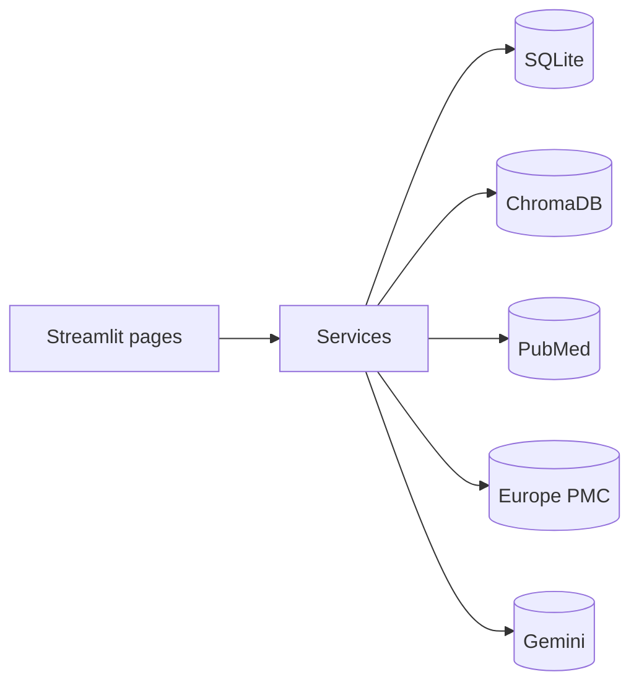

# 🩺 ZETESIS AI

**"Should I do this research?" - an idea validator and evidence-gap finder for medical researchers
(built around Khyber Pakhtunkhwa, works for any region).**
Write your research idea and get a **GO / MODIFY / LEAVE** answer, the closest existing studies and
the untouched angles. Then search PubMed and Europe PMC, build a local research library, ask questions that are answered
*only* from the papers you saved (with citations), compare studies, surface limitations and
**possible** research gaps, and export a PDF evidence report.

> ⚠️ **Medical disclaimer.** ZETESIS AI supports *literature research only*. It does not
> provide medical diagnosis or treatment advice and does not replace professional medical judgment.

---

## Table of contents
1. [Project overview](#1-project-overview)
2. [Problem statement](#2-problem-statement)
3. [Key features](#3-key-features)
4. [System architecture](#4-system-architecture)
5. [Technology stack](#5-technology-stack)
6. [Folder structure](#6-folder-structure)
7. [Installation](#7-installation-windows--vs-code)
8. [API configuration](#8-api-configuration)
9. [Running the app](#9-running-the-app)
10. [Example usage](#10-example-usage)
11. [Example output](#11-example-output)
12. [Database design](#12-database-design)
13. [Testing](#13-testing)
14. [How the "analysis" modules work (no fake agents)](#14-how-the-analysis-modules-work)
15. [Ethical and medical safety](#15-ethical-and-medical-safety)
16. [Limitations](#16-limitations)
17. [Future improvements](#17-future-improvements)
18. [Troubleshooting](#18-troubleshooting)
19. [Hackathon demo script](#19-hackathon-demo-script)
20. [Credits and references](#20-credits-and-references)

---

## 1. Project overview
ZETESIS AI is a Streamlit application that turns a research topic (e.g.
*"Diabetes in rural Khyber Pakhtunkhwa, 2015-2025"*) into an organised, searchable, cited body of
evidence. Everything is stored locally (SQLite + ChromaDB), runs on a laptop, and works even
without an AI key (in a clearly labelled limited mode).

## 2. Problem statement
Researchers, students and public-health teams in KP spend days finding scattered papers, reading
abstracts, and working out what is already known. Generic chatbots can invent references.
ZETESIS AI only uses papers that were actually retrieved from PubMed / Europe PMC, cites
them, says "insufficient evidence" when the papers do not answer the question, and never claims a
topic is unresearched just because a search returned few results.

## 3. Key features
| Page | What it does |
|---|---|
| **Idea Check** (start here) | Write an idea in English (or Urdu with Gemini). It is split into topic / population / intervention / outcome / place / design, PubMed is counted for the whole idea and for each part, and a **rule-based** verdict is shown: GO (few papers), MODIFY (studied, but a part is thin) or LEAVE (well covered and a recent review exists). Shows the region ladder (your region -> country -> world), study-design coverage, untouched angles, the closest studies with evidence badges (RCT / review / retracted warning), the exact PubMed queries, a PDF download, and a one-click "save and run gap analysis". |
| **Dashboard** | Counts, recent topics, quick search, evidence-label legend, configuration notices. |
| **Research Discovery** | Topic / keywords / region / year range / max papers → PubMed + Europe PMC → de-duplicated list → save and index selected papers. |
| **Research Library** | Browse and filter saved papers, open-access status, abstract-only warnings, re-index. |
| **Research Assistant** | Retrieval-augmented Q&A with validated `[S#]` citations, insufficient-evidence handling, clinical-advice refusal. |
| **Research Comparison** | Side-by-side table of design, population, sample size, methods, findings, limitations. |
| **Research Gap Analysis** | Author-stated limitations, AI-inferred *possible* gaps, suggested research questions (kept visibly separate). |
| **Reports** | 10-section PDF report with references, evidence labels and disclaimers. |

Safety and robustness: timeouts, retries with back-off, rate limiting, input validation, key
redaction, offline fallback when Gemini is missing or failing, no fabricated references.

### How Idea Check differs from Elicit, Consensus, Scite and OpenEvidence
Those tools answer a *question about existing evidence*. Idea Check answers the researcher's earlier
question: **"is my idea worth doing, and what should I change?"** The verdict is computed from
transparent PubMed counts (not an AI opinion), the numbers and queries are shown so they can be
checked, and the evidence is split by region so a KP/Pakistan researcher can see how much of it is local.
Counts come from title/abstract keyword matching, so a low count is a hint, not proof, that a topic is untouched.

## 4. System architecture
Layered design: **Streamlit UI → services → SQLite / ChromaDB / file cache → external APIs**.
Full diagrams (Mermaid, render on GitHub and in VS Code with a Mermaid extension):

* [`diagrams/system_architecture.md`](diagrams/system_architecture.md)
* [`diagrams/data_flow.md`](diagrams/data_flow.md) (DFD level 0 and 1)
* [`diagrams/erd.md`](diagrams/erd.md)



## 5. Technology stack
Python 3.11 · Streamlit · Google GenAI SDK (Gemini) · LangChain text splitters/documents ·
ChromaDB · PubMed E-utilities · Europe PMC REST · SQLite · ReportLab · Plotly · python-dotenv ·
Pydantic v2 · Pytest.

## 6. Folder structure
```
zetesis_ai/
├── app.py                     Streamlit entry point + navigation
├── requirements.txt           dependency ranges
├── requirements-tested.txt    exact versions the tests passed with
├── .env.example               configuration template
├── pytest.ini
├── .streamlit/config.toml     theme
├── config/                    settings.py (env/config), prompts.py (all LLM prompts + labels)
├── database/                  db.py (schema), models.py (Pydantic/dataclasses), repositories.py
├── services/                  pubmed, europe_pmc, deduplication, document_processor,
│                              idea_service (Idea Check), idea_pdf, evidence_labels,
│                              embedding, vector_store, gemini, paper_service, rag_service,
│                              research_analysis, gap_detection, analysis_pipeline,
│                              pdf_service, report_service, container
├── frontend/                  one module per page + state.py + theme.py
├── utils/                     helpers, http (retry), validators, citation_utils
├── tests/                     142 tests + synthetic fixtures
├── diagrams/                  architecture, DFD, ERD (Mermaid)
├── docs/                      workflow, installation, methodology, limitations
└── data/                      created at runtime: SQLite, chroma_db/, papers/, reports/
```

## 7. Installation (Windows + VS Code)
```powershell
py -3.11 -m venv .venv
.\.venv\Scripts\Activate.ps1
python -m pip install --upgrade pip
pip install -r requirements.txt
Copy-Item .env.example .env
notepad .env
python -m database.db
```
More detail: [`docs/installation.md`](docs/installation.md).

## 8. API configuration
Edit `.env` (never commit it):

| Variable | Required | Notes |
|---|---|---|
| `GEMINI_API_KEY` | recommended | <https://aistudio.google.com/apikey>. Without it the app runs in limited mode. |
| `GEMINI_MODEL` | optional | Default `gemini-3.5-flash`. Set a current model name if Google renames models. |
| `NCBI_API_KEY` | optional | Raises PubMed limit from 3 to 10 requests/second. |
| `NCBI_EMAIL` | optional | NCBI asks API users to identify themselves. |
| `GEMINI_EMBEDDING_MODEL`, `FORCE_LOCAL_EMBEDDINGS`, `ZETESIS_DATA_DIR` | optional | See `.env.example`. |

## 9. Running the app
```powershell
streamlit run app.py
```
Open <http://localhost:8501>.

## 10. Example usage
1. **Research Discovery** → topic `Diabetes`, keywords `HbA1c, prevalence`, region
   `Khyber Pakhtunkhwa`, years 2015-2025, max 30 papers → **Search PubMed + Europe PMC**.
2. Tick the relevant papers → **Save and index selected papers**.
3. **Research Assistant** → *"What prevalence of diabetes was reported in KP?"*
4. **Research Comparison** → select 3-6 papers → **Compare selected papers**.
5. **Research Gap Analysis** → **Run analysis** → review limitations, possible gaps, questions.
6. **Reports** → generate and download the PDF.

## 11. Example output
The shapes below are illustrative; real output depends on the papers you retrieve.

**Assistant (evidence found)**
```
Prevalence estimates differ by district and diagnostic criteria [S1][S3].
Sources
[S1] Author et al., Year - Title (Journal) - PMID ...
```
**Assistant (not enough evidence)**
```
Insufficient evidence in the indexed papers to answer this question.
```
**Gap card**
```
Gap 2: No randomized or interventional studies were identified among the retrieved papers.
[Methodology] [Coverage analysis (rules)] [Needs further verification]
Why this was identified: None of the 5 retrieved papers mention a randomized, trial or
intervention design. This may reflect the limits of the search rather than a true gap.
```

## 12. Database design
SQLite holds metadata, analyses, gaps, questions and report records; ChromaDB holds chunk text
and vectors. The nine required entities (ResearchTopic, ResearchPaper, PaperAuthor,
DocumentChunk, ResearchQuery, ResearchAnalysis, ResearchGap, ResearchQuestion,
GeneratedReport) are implemented, plus two associative tables (`topic_paper`,
`gap_supporting_paper`). See [`diagrams/erd.md`](diagrams/erd.md).

## 13. Testing
```powershell
pytest
```
142 tests cover Idea Check (query building, verdict rules, PDF, UI), PubMed and Europe PMC parsing and queries (mock HTTP), de-duplication, document
processing, ChromaDB indexing/retrieval, RAG (insufficient evidence, citations, clinical-advice
refusal), Gemini fallback, comparison, gap detection, PDF generation, database repositories and
Streamlit UI smoke tests. **No network or API key is required.**

> The test fixtures are **synthetic** (labelled `[TEST FIXTURE]`, fake PMIDs/DOIs). The app ships
> with **no** sample papers; all results come from live searches.

## 14. How the analysis modules work
Summaries, limitation extraction, comparison, gap discovery and research-question generation are
**pipeline functions** run by `AnalysisPipeline`, not autonomous or independent "agents". Each
function reads papers from the database, optionally calls Gemini, validates the output, and
stores it with a label showing where it came from (`gemini` or rule-based).
See [`docs/methodology.md`](docs/methodology.md).

## 15. Ethical and medical safety
* Literature support only: no diagnosis, dosing or treatment advice (such requests are declined).
* References come only from retrieved records; invalid citations are stripped.
* Four label types are kept apart: *finding supported by research*, *limitation stated by authors*,
  *AI-inferred possible gap*, *recommendation needing verification*.
* Few results ≠ unresearched topic. This is stated in the UI and the PDF.
* Only open-access full text is downloaded; otherwise abstracts are used and flagged.
* API keys live in `.env`, are never displayed, and are removed from error messages.
* Always verify against the original papers before relying on any output.

## 16. Limitations
See [`docs/limitations.md`](docs/limitations.md). Highlights: two sources only, abstract-heavy
evidence, lexical-only retrieval without Gemini, regex-based fallbacks, PDF limited to
Western-European characters, local single-user storage. Live PubMed / Europe PMC / Gemini calls
were not exercised in the build environment (network blocked); behaviour is covered by mocked
tests, so run one real search to confirm in your environment.

## 17. Future improvements
Urdu / Pashto interface and PDF fonts, more sources (e.g. Pakistan Journal of Medical Sciences
indexes, Crossref), user-uploaded PDFs, citation-network view, systematic-review screening
workflow, multi-user deployment with authentication, evaluation set for RAG quality.

## 18. Troubleshooting
See [`docs/installation.md`](docs/installation.md#troubleshooting).

## 19. Hackathon demo script (about 5 minutes)
1. **(30 s) Problem.** "Researchers spend weeks on an idea that was already done. Existing tools
   (Elicit, Consensus, OpenEvidence) summarise papers; none tells you whether *your idea* is worth doing."
2. **(90 s) Idea Check.** Click an example ("School exercise and obesity (Peshawar)") -> **Check my idea**.
   Show the verdict, the region ladder (Peshawar -> Pakistan -> world), the untouched angles, and open
   "Numbers behind the verdict" to show the exact PubMed queries. Download the PDF.
3. **(45 s) Change the idea.** Apply a suggested angle (a different design or a narrower group) and run again:
   the verdict moves from LEAVE/MODIFY toward GO. This shows the tool changes a decision.
4. **(60 s) Go deeper.** Click **Save the closest papers and run the full gap analysis**; open the Assistant and
   ask a question (cited `[S#]`); ask something unrelated to show **insufficient evidence**.
5. **(30 s) Honesty.** Point at the caveat that counts are keyword-based: few results is a hint, not proof.
6. **(15 s) Wrap-up.** Local, private, works without a key (English), rule-based verdict, tested, honest about limits.

## 20. Credits and references
* NCBI E-utilities (PubMed): <https://www.ncbi.nlm.nih.gov/books/NBK25501/>
* Europe PMC REST API: <https://europepmc.org/RestfulWebService>
* Google Gen AI SDK / Gemini API: <https://ai.google.dev/>
* Streamlit, ChromaDB, LangChain, ReportLab, Plotly, Pydantic, Pytest.

Built for a Khyber Pakhtunkhwa AI hackathon. Evidence sourced from PubMed and Europe PMC; all
rights to the papers remain with their authors and publishers.
