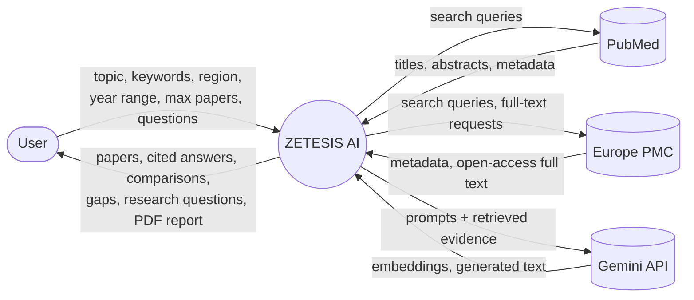
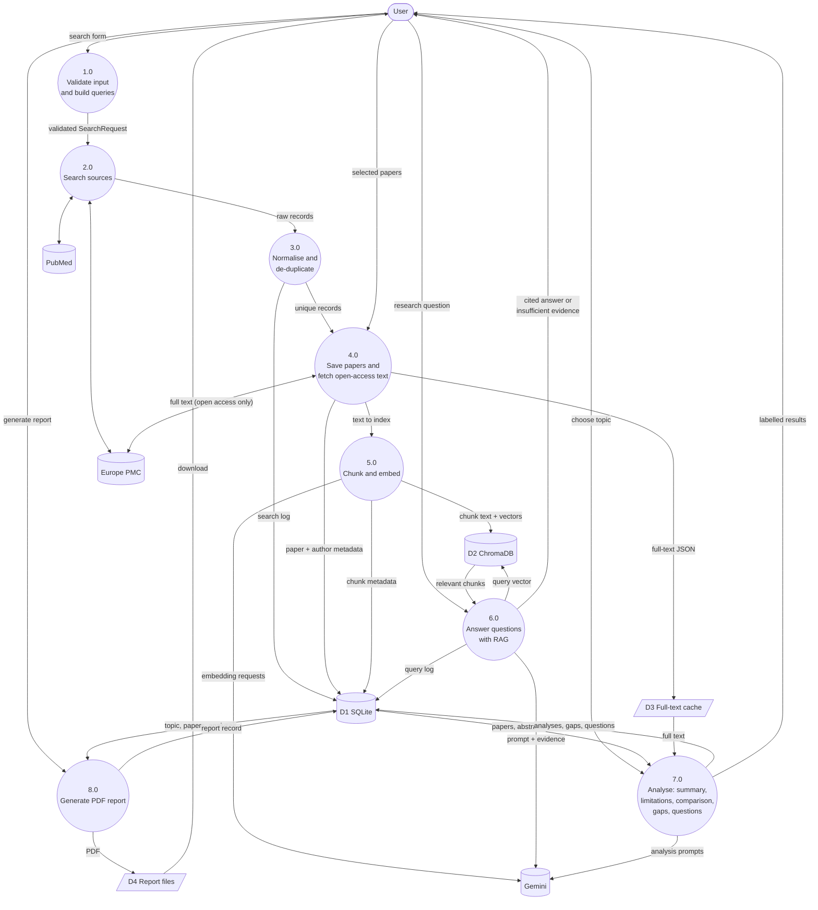

# Data flow diagrams

## Level 0 (context diagram)

## Level 1

### Notes

* Every Gemini arrow is optional. Without a key the app uses the offline embedder and
  rule-based extraction, and says so on screen.
* Process 4.0 only downloads full text when Europe PMC reports the paper as open access.
* Process 7.0 labels its output: *finding supported by research*, *limitation stated by
  authors*, *AI-inferred possible gap*, *recommendation needing verification*.
