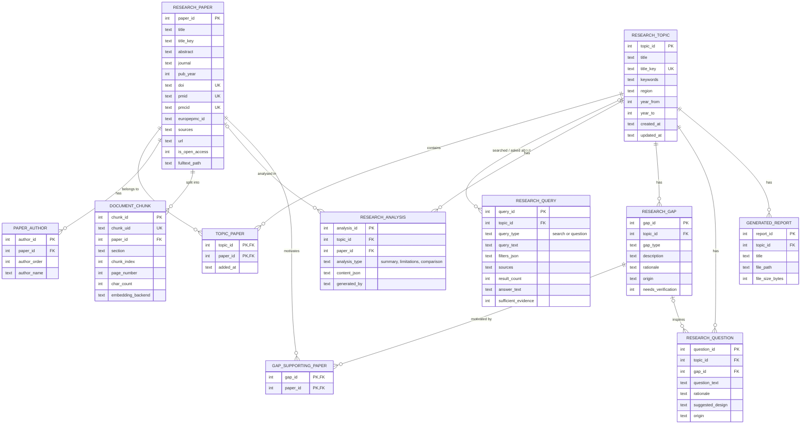

# Entity relationship diagram

The nine required entities are `ResearchTopic`, `ResearchPaper`, `PaperAuthor`,
`DocumentChunk`, `ResearchQuery`, `ResearchAnalysis`, `ResearchGap`, `ResearchQuestion`
and `GeneratedReport`. Two **associative tables** (`topic_paper`, `gap_supporting_paper`)
implement many-to-many relationships.

## Relationship explanation

| Relationship | Meaning |
|---|---|
| Topic ↔ Paper (via `topic_paper`) | Many-to-many. The same paper can appear in several topics; saving it twice never duplicates it. |
| Paper → Author | One paper has many ordered authors. |
| Paper → Chunk | One paper is split into many chunks. Only metadata is in SQL; the text and vector are in ChromaDB under `chunk_uid`. |
| Topic → Query | A search run or a question asked in the assistant. `topic_id` is optional (questions may span all papers). |
| Topic / Paper → Analysis | Summaries and limitations are per paper; a comparison belongs to the topic (`paper_id` is NULL). |
| Topic → Gap, Gap ↔ Paper | Gaps belong to a topic and list the papers that motivated them. A gap derived from "what is missing" may have none. |
| Gap → Question | A suggested research question may be linked to the gap that inspired it. |
| Topic → Report | Generated PDFs are registered with their path and size. |

Deleting a topic or a paper cascades to dependent rows (`PRAGMA foreign_keys=ON`).
Large text (chunks, full text) is intentionally **not** duplicated in SQL.
