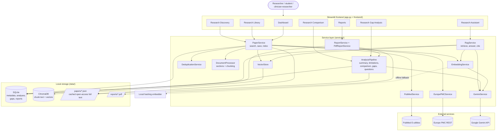

# System architecture

ZETESIS AI is a layered application. Each layer only calls the layer below it, so
every piece can be tested (and replaced) on its own.

## Component responsibilities

| Layer / component | Responsibility |
|---|---|
| `app.py`, `frontend/*.py` | Streamlit pages, forms, tables, charts, progress bars. No business logic, only calls services and shows results and friendly error messages. |
| `PaperService` | Orchestrates search (PubMed + Europe PMC), de-duplication, saving to SQLite, full-text retrieval (open access only), chunking and indexing. Reuses chunks that are already embedded. |
| `PubMedService` | Builds the PubMed query, calls `esearch` + `efetch`, parses XML into `PaperRecord`s. Rate limited and retried. |
| `EuropePMCService` | Builds the Europe PMC query, parses `core` results, downloads JATS full text for open-access papers. |
| `DeduplicationService` | Merges records with the same DOI / PMID / PMCID / long normalised title, keeping the richest data. |
| `DocumentProcessor` | Splits abstracts and JATS full text into sections, then into overlapping chunks (1200 chars / 150 overlap) with metadata. |
| `EmbeddingService` | Gemini embeddings, or an offline keyword (hashing) embedder when Gemini is not available. |
| `VectorStore` | ChromaDB persistent collection (cosine). Scoped queries by paper id. |
| `RagService` | Retrieval, relevance threshold, prompt, Gemini answer, citation validation, "insufficient evidence" handling, clinical-advice refusal, extractive fallback. |
| `ResearchAnalysisService` | Per-paper summaries, author-stated limitations, structured comparison (Gemini with rule-based fallback). |
| `GapDetectionService` | Rule-based coverage analysis plus Gemini suggestions for possible gaps; generates research questions. |
| `AnalysisPipeline` | Runs the analysis functions above in order and caches results in SQLite. These are pipeline functions, not independent agents. |
| `PdfReportService` / `ReportService` | Assemble a 10-section PDF report with ReportLab and register it in SQLite. |
| `GeminiService` | The only place that talks to Gemini: retries, JSON mode, friendly errors, no key leakage. |
| SQLite | Source of truth for metadata, analyses, gaps, questions and report records. |
| ChromaDB | Chunk text and embedding vectors (not duplicated in SQL). |
